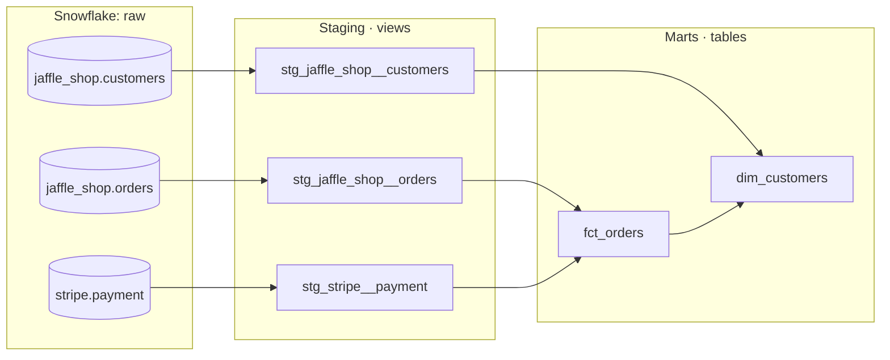

# Jaffle Shop – dbt on Snowflake

A dbt project that transforms raw e-commerce data (customers, orders and Stripe payments) into analytics-ready tables in Snowflake. Built while working through the [dbt Fundamentals](https://learn.getdbt.com/courses/dbt-fundamentals) course, with my own additions and refactors along the way.

**Stack:** dbt (dbt Studio) · Snowflake · GitHub

## Lineage



## Project structure

```
models/
├── staging/          # 1:1 with source tables: renaming, type fixes, no joins (views)
│   ├── jaffle_shop/
│   └── stripe/
└── marts/            # business-ready fact and dimension tables (tables)
macros/
└── configure_warehouse.sql
tests/                # singular data tests
```

## Models

| Model | Description |
|---|---|
| `stg_jaffle_shop__customers` | Cleaned customer records |
| `stg_jaffle_shop__orders` | Cleaned orders with status |
| `stg_stripe__payment` | Stripe payments, amounts converted from cents to dollars |
| `fct_orders` | One row per order with the total of successful payments |
| `dim_customers` | One row per customer with order history and lifetime value *(in progress)* |

## Data quality

- **Generic tests:** `unique` and `not_null` on primary keys, `accepted_values` on order status, and a `relationships` test ensuring every order belongs to a known customer.
- **Singular test:** `assert_stg_stripe__payment_total_positive` fails if any order's total payment amount is negative.
- **Source freshness:** configured on `jaffle_shop.orders` and `stripe.payment` (warn after 12 hours, error after 24). The course sample data is static, so these checks are expected to report stale data.

## Cost optimization

After about two days of development, the Snowflake trial showed roughly $21 in compute (5.46 credits), almost all of it on the `transforming` warehouse used by dbt. Two default settings were responsible:

1. **Auto-suspend of 600 seconds.** Every short dbt command kept the warehouse running for ten more minutes. Reduced to 60 seconds, which matches Snowflake's one-minute billing minimum per resume.
2. **Gen2 hardware.** New warehouses now default to Gen2, which bills an X-Small at 1.35 credits/hour instead of 1 on AWS. Its speed advantage doesn't matter for small development queries, so the warehouse was switched back to Gen1.

Both settings are applied through a dbt macro, so the configuration lives in version control rather than being a one-off manual change:

```bash
dbt run-operation configure_warehouse
# or with custom values
dbt run-operation configure_warehouse --args '{auto_suspend: 120}'
```

The dbt role needs `MODIFY` privilege on the warehouse to run it.

## Running the project

```bash
dbt deps                 # install packages (codegen)
dbt build                # run all models and tests in DAG order
dbt source freshness     # check source data freshness
```

## Roadmap

- [ ] Finish `dim_customers`
- [ ] Add tests for `stg_stripe__payment`
- [ ] Add model and column descriptions and generate dbt docs
- [ ] Move shared payment logic into an intermediate layer, so `dim_customers` no longer depends on `fct_orders`